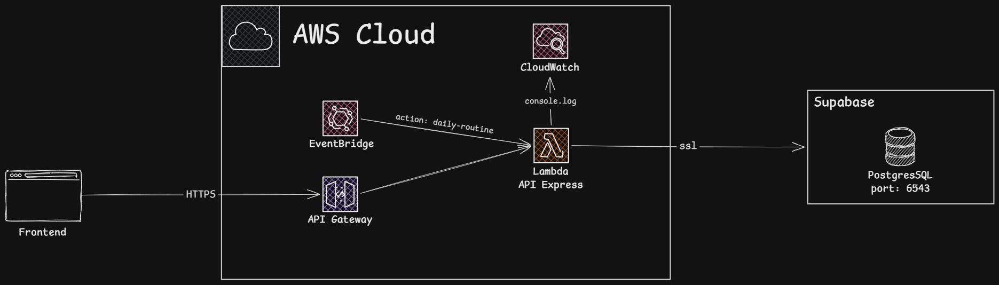
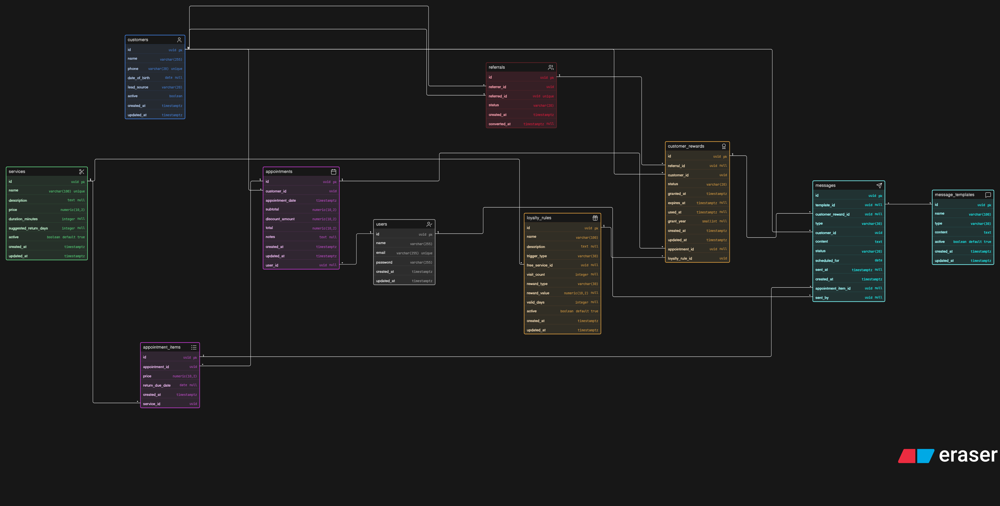
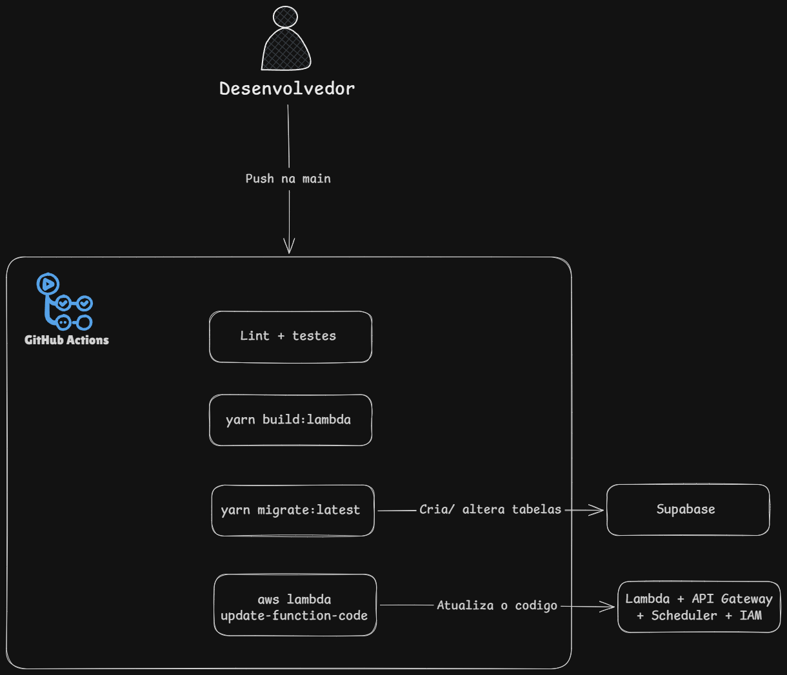

# fidelizei-api

[](https://opensource.org/licenses/MIT)

**Fidelizei** é um projeto Node.js que permite aos usuários gerenciar clientes, atendimentos, serviços e programas de fidelidade.
visando fidelizar clientes e conquistar novos..

## Tecnologias

- [Node](https://nodejs.org/en/)
- [Express](https://expressjs.com/pt-br/)
- [Pino](https://getpino.io/)
- [Knex](https://knexjs.org/)
- [PostgreSQL](https://www.postgresql.org/)
- [Vitest](https://vitest.dev/)
- [Biome](https://biomejs.dev/pt-br/)
- [Terraform](https://developer.hashicorp.com/terraform)

## Arquitetura

Abaixo, um diagrama simplificado:



## Instalação

> OBS: E NECESSARIO CONFIGURAR O ARQUIVO .ENV

1. Clonar o repositório:

   ```bash
   git clone https://github.com/7feeh7/fidelize-api.git
   ```

2. Instalando as dependências:

   ```bash
   yarn install
   ```

3. Configurar banco de dados:

- Crie um banco de dados PostgreSQL para aplicação
- Renomeie o arquivo .env.example para .env e atualize os detalhes da conexão do banco de dados

4. Inicie o servidor:

   ```bash
   yarn run start:dev
   ```

Ou usando Docker

Subir a aplicação:

```bash
docker compose up -d --build
```

Para parar os containers preservando os dados:

```bash
docker compose down
```

O servidor agora deve estar em execução em http://localhost:3000 (porta definida em `PORT` no `.env`, padrão `3000` no código).

## Diagrama de Entidade-Relacionamento



## Pipeline CI/CD



## Documentação

- [API HTTP e autenticação](docs/api.md)
- [Banco de dados](docs/database.md)
- [Deploy na AWS (Lambda + Terraform)](docs/deploy.md)

## Contribuindo

Contribuições para o projeto são bem vindas! Pra contribuir com o projeto, siga estas etapas:

1. De um fork no repositorio.
2. Crie uma nova branch para sua feature ou bug fix.
3. Faça suas alterações, confirmando e pressionando conforme necessário.
4. Envie uma solicitação pull com uma descrição detalhada de suas alterações.

## Contato

Para qualquer dúvida ou consulta, entre em contato com [F-softtech](mailto:felipe.pires.soaresti@gmail.com).

Sinta-se à vontade para entrar em contato conosco se tiver algum comentário, sugestão ou se encontrar algum problema ao usar o fidelize-api. Sua opinião é valiosa para nós e nos ajuda a melhorar a aplicação.
